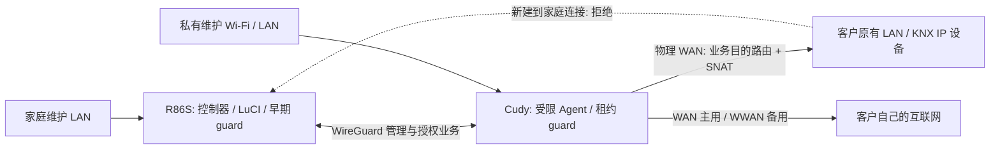

# 架构

文中的地址全部来自示例模板，不对应现场地址。

## 四种网络角色

| 角色 | 示例 | 用途 |
|---|---|---|
| 家庭维护 LAN | `10.60.0.0/24` | 整段可作为授权维护源 |
| Cudy 私有 LAN | `10.61.1.0/24` | 维护者独用 Wi-Fi，不是客户上游 LAN |
| WG 管理段 | `10.62.0.0/24` | 服务端 `.1`，示例网关 `.11` |
| 客户真实 LAN | 运行时物理 WAN DHCP 检测 | 不预置，不使用虚拟 DNAT |

家庭到真实客户目标在 Cudy **只做出口 masquerade** 以获得回包；家庭与私有维护 LAN 使用正常路由，不新增隐藏私有维护源的 SNAT。客户主路由无须添加回程路由。

## 控制链与失败关闭

LuCI → `knx.customer` 受限 RPC → `knx-customer` 包装器 → 控制器。网页不直接控制 nft 或 WireGuard。

控制器经专用、固定主机密钥的 SSH 主动查询 Agent。Agent 只接受指定管理源及 `probe/activate/renew/deactivate`，使用候选指纹绑定物理 WAN 租约、地址、网关和网关 MAC；不向客户发放家庭路由器登录权限。

ON 前先关闭既有业务归属，检查系统路由、配置路由、其他 Peer AllowedIPs 和 NAT 目标冲突。无有效物理 WAN、候选变化或协调失败均拒绝 ON。成功后才设置真实网段归属、两端路由及短租约。监控约每 10 秒续期，nft 租约为 45 秒；调度和网络延迟会影响实际关闭时限，不能视为硬实时保证。

| 状态 | Peer | 业务路由/授权 | WG 管理 |
|---|---|---|---|
| ON | 存在 | 有效候选 + 双端租约 | 保留 |
| OFF | 存在 | 撤销，定向清理业务连接跟踪 | 保留 |
| DISCONNECT | 移除，UCI 保存禁用 | 无 | 断开 |
| RECONNECT 后 | 恢复 | 默认 OFF，须显式 ON | 恢复 |

磁盘初始 gate 为空，启动/停止与 fw4 reset 使用 reconcile/reset。业务不会因服务启动自动 ON；Peer 禁用状态保存在 UCI。ON 不承诺跨重启自动恢复，这也是安全默认值。

## 路由和规则所有权

| 设备 | 表/优先级 | 职责 |
|---|---|---|
| R86S | 表 191；1709/1710 | 当前客户私有 LAN/真实 LAN，动态创建与撤销 |
| R86S | 1700/1702 | 私有源到家庭回程主表、管理段主表 |
| Cudy | 表 189；1700/1701 | 私有维护源/网关 WG 源到家庭 |
| Cudy | 表 190；1680/1681 | 家庭到物理 WAN 真实 LAN 及其回程 |
| Cudy | 表 192/193；1695/1696 | 指定源地址和小范围 TCP 源端口的上联健康探测 |
| Cudy | 协议 187、metric 10 | 健康管理器独占的 WAN 优先默认路由 |

这些表号和优先级是 V1.0 的保留接口，不是自动安全分配器。部署必须验证冲突。**R86S 不得再添加“目的私有维护 LAN → lookup main”的旧 1701 规则**，它会抢走动态表 191 回程；Cudy 的同号规则是不同设备上的合法管理源规则。

## 防火墙与 OpenClash

R86S prerouting `-190` 拒绝未授权业务；forward `-10` 限定接口、源、目的和租约，在普通 fw4 转发前生效。Cudy forward guard 同样早于常规 fw4 established/related；上游返回家庭只接受真实网段的合法回复。IPv6 WG 转发明确拒绝，不把 IPv4 权限自动扩展至 IPv6。

独立 nft 基链中的 ACCEPT 不意味着跳过所有后续链；仍须合并受控 fw4 正向规则。反之早期 DROP 是撤权保障。不能为了兼容代理添加无条件 WG→LAN ACCEPT。

OpenClash 兼容 hook 默认为不渲染，只有确认现有 fwmark/TUN/表及优先级契约时启用。上联 HTTPS 包装器使用已有 GID 65534 绕行契约：该行为并非通用代理兼容方案，须在部署设备审阅。不修改 OpenClash 自身配置。

## 互联网主备与域名

netifd 保留 WAN metric 30、WWAN metric 20；WAN 健康两次后增加自身 metric 10 路由，两次失败撤销，恢复有防抖。探测通过指定源/端口的独立表访问证书校验的 DoH，不把普通客户端或 WG UDP 引入探测表。并非安装 mwan3，也不是全流量负载均衡。

Endpoint 使用配置域名，Cloudflare DoH 主/备与 AliDNS 备用，拒绝 Fake-IP、私网及列明的特殊 IPv4；解析失败保留最后地址。WAN/WWAN hotplug 和低频循环刷新运行时 Endpoint。接口 `nohostroute=1` 防止旧 Endpoint 主机路由锁死出口。公网地址过滤是 V1.0 的静态列表，不等于永远完整的 IANA 特殊用途数据库。
